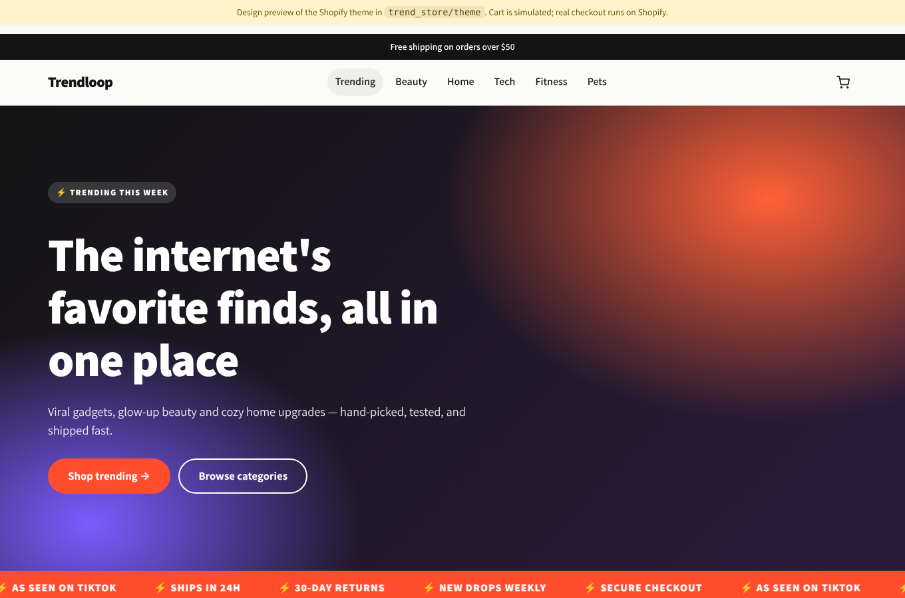

# Trendloop: a Shopify store for trending products

A ready-to-upload Shopify store: an Online Store 2.0 theme plus a catalog of 18
trending products (44 variants), each linked to real Alibaba suppliers, as a Shopify import CSV.



## What's in here

| Path | What it is |
| --- | --- |
| `theme/` | Shopify OS 2.0 theme (Liquid). Upload it as-is. |
| `products.csv` | Product import file: 18 products, 44 variants, prices, compare-at prices, cost per item, SKUs, tags, SEO fields. |
| `sourcing.csv` | Supplier sheet: 2 Alibaba listings per product with price, MOQ, margin and what to confirm. |
| `data/products.json` | Source of truth for the catalog. Edit this, then rebuild. |
| `scripts/build_catalog.py` | Regenerates `products.csv` and `preview/products.js` from the JSON. |
| `preview/index.html` | Static design preview with a simulated cart. Open it in a browser; no store needed. |

### Theme features

- **Homepage:** rotating announcement bar, gradient hero (or your own image), scrolling
  "trending" ticker, featured collections, round category tiles, trust badges, newsletter signup.
- **Product page:** media gallery with thumbnails (images, video, 3D), variant pills that
  cross out sold-out combinations, quantity stepper, Shop Pay/Apple Pay dynamic checkout,
  perks list, collapsible tabs, app blocks, and related-product recommendations.
- **Cart drawer:** add to cart without leaving the page, edit quantities in the drawer, and a
  free-shipping progress bar ("You're $12.01 away from free shipping").
- **Product cards:** sale % badge, "Trending" badge (any product tagged `trending`), second
  image on hover, one-click quick add.
- **Collections and search:** storefront filters (works with Shopify's Search & Discovery app),
  sorting, active-filter pills, pagination.
- Customer accounts, contact page, blog, password ("opening soon") page, gift card page.
- Every section and setting can be edited in the theme editor (colors, fonts, layout, cart type,
  social links).
- Passes Shopify Theme Check (all 85 checks, 0 offenses).

## Launch checklist

### 1. Upload the theme

**Option A: zip upload (no tools needed)**

```bash
cd trend_store/theme && zip -r ../trendloop-theme.zip . && cd -
```

In Shopify admin, go to **Online Store → Themes → Add theme → Upload zip file** and pick
`trendloop-theme.zip`. Then click **Customize** to preview it, and **Publish** when you're ready.

**Option B: Shopify CLI**

```bash
npm install -g @shopify/cli
shopify theme dev  --path trend_store/theme --store your-store.myshopify.com   # live local preview
shopify theme push --path trend_store/theme --store your-store.myshopify.com --unpublished
```

### 2. Import the products

Go to **Products → Import**, choose `products.csv`, and confirm. Every variant starts with
50 units in stock; change that in `scripts/build_catalog.py` (`DEFAULT_INVENTORY`) or in the admin.

> **Add your own product photos.** The CSV has no images, because you need photos you have the
> rights to, usually from your supplier. Until you add them, the theme shows tidy placeholders.

### 3. Create the collections

The homepage looks for these collection handles. Create each one in **Products → Collections**
as an *automated* collection, so products are added by tag automatically:

| Title | Handle | Condition |
| --- | --- | --- |
| Trending | `trending` | Product tag is equal to `trending` |
| Beauty | `beauty` | Product tag is equal to `beauty` |
| Home | `home` | Product tag is equal to `home` |
| Tech | `tech` | Product tag is equal to `tech` |
| Fitness | `fitness` | Product tag is equal to `fitness` |
| Pets | `pets` | Product tag is equal to `pets` |
| Kitchen | `kitchen` | Product tag is equal to `kitchen` |
| Under $30 | `under-30` | Product price is less than `30` |

### 4. Menus

In **Online Store → Navigation**:
- **Main menu** (`main-menu`): Trending, Beauty, Home, Tech, Fitness, Pets.
- **Footer** (`footer`): Shipping policy, Refund policy, Contact (create a page that uses the
  `page.contact` template).

### 5. Store settings

- **Shipping:** add a free-shipping rate for orders of $50 or more, to match the banner and cart bar.
  The theme only *displays* the threshold. Change it in **Theme settings → Cart**.
- **Payments:** turn on Shopify Payments / Shop Pay.
- **Policies:** generate refund, privacy, terms and shipping policies in **Settings → Policies**.
  They appear in the footer automatically.
- **Domain**, plus a logo and favicon in the theme editor.

### 6. Before you go live: check these

- **Product names and claims are starting points.** Names like "GlowSkin" are original placeholders.
  Make sure every spec in the descriptions (light wavelengths, battery life, 1080p, weights) matches
  what your supplier actually ships, and don't make medical claims (for example, for the LED mask
  or posture corrector).
- **Prices** include compare-at prices to show savings. Only use a compare-at price that reflects a
  real former or market price; many regions regulate "was/now" pricing.
- **Customer quotes:** the "What customers are saying" section is **disabled** by default and
  contains placeholder text. Only turn it on once you have real reviews (or use a reviews app
  such as Judge.me, which adds its own app blocks to the product page).

## Sourcing the products (Alibaba)

`sourcing.csv` lists **two real Alibaba listings per product** (36 in total): the URL, listing title,
supplier, unit price, MOQ, estimated gross margin, and a **"Confirm With Supplier"** checklist.
The same data lives under `sourcing` in `data/products.json`. Shopify's **Cost per item** is filled
from the primary supplier's highest listed price wherever one was found, so the admin's profit
reports work from day one.

| Product | Our price | Unit cost seen | Est. margin* | Primary supplier |
| --- | ---: | ---: | ---: | --- |
| Sunset Halo Projection Lamp | $29.99 | $7.58 | 75% | Guangzhou Canmei Lighting |
| BlendGo Portable Blender | $34.99 | $9.10 | 74% | Shenzhen Denorgin Tech |
| ChillRoll Ice Face Roller | $16.99 | $7.99 | 53% | Guangzhou Baiyun Tuying |
| MagSnap Magnetic Car Mount | $27.99 | $1.10 | 96% | Shenzhen Natek Technology |
| PocketCine Mini Projector | $119.99 | $44 | 63% | Shenzhen Shengxinze Technology |
| AlignPro Posture Corrector | $22.99 | $3.35–3.98 | 83% | Hebei Youjie Medical Devices |
| GlowStrip Motion Sensor Lights | $26.99 | $1.84 | 93% | Guangzhou Houde Lighting |
| CozyWeight Knit Blanket | $79.99 | $13.40–44.80 | 44% | Ningbo Jemo Textile Tech |
| FlexBand Resistance Bands | $24.99 | $0.95–3.50 | 86% | Shenzhen Shenzhouxing |
| SpinScrub Electric Brush | $39.99 | $11 | 72% | Zhejiang Easy Housewares |

\*Margin at the high end of the unit price, **before shipping, duties, payment fees and ads**.
The other 8 products have supplier links but no price shown in search results; ask for a quote.

**How this was gathered, and what to check.** The listings were found through web search of
alibaba.com. Every URL came straight from search results, but prices, MOQs and some supplier names
came from search summaries, not the live page, so treat them as leads. For each product:

1. Open both links and message the supplier with the "Confirm With Supplier" points.
2. Get a quote including shipping to your country (or to your dropship agent), and the MOQ.
3. **Order a sample** before listing anything, and photograph it yourself (or get photo rights).
4. For electronics, beauty devices and anything worn on the body, ask for test reports
   (CE/FCC/RoHS, and battery UN38.3 for anything with a lithium battery) before you sell.
5. Avoid listings for branded items (for example Phomemo printers) unless you're an authorized
   reseller, and don't use another brand's name in your product titles.

Descriptions were adjusted to match the listings: the projector is 720p native (plays 1080p video),
the earbuds no longer claim transparency mode, and the motion lights are a 2-pack. Specs no
listing confirmed, such as battery-life numbers, were removed. If your supplier confirms more,
add it back in `data/products.json`.

Alibaba suppliers usually sell in bulk. If you'd rather not hold stock, ask the supplier whether
they dropship, or use a dropshipping app (DSers, CJdropshipping, Spocket, Zendrop) and search for
the same items there.

## Editing the catalog

```bash
# edit trend_store/data/products.json, then:
python3 trend_store/scripts/build_catalog.py
```

Each product has a title, type, tags (which drive collections and the Trending badge), price,
compare-at price, weight, description bullets, and up to three options (for example Size × Color).
The script generates every variant combination with unique SKUs.

## Preview

Open `preview/index.html` in a browser. It uses the theme's real stylesheet and the generated
catalog data, so it matches what the theme looks like with products loaded. It uses emoji
artwork in place of product photos, and the cart is simulated in the browser.
